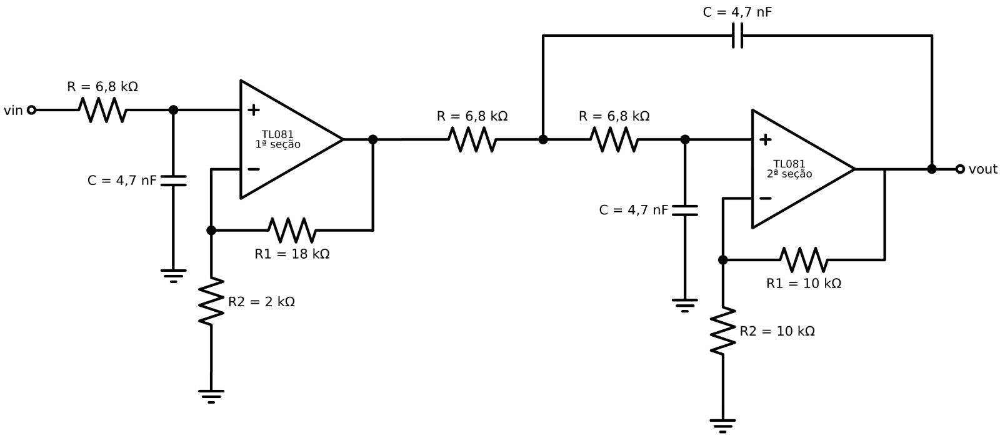
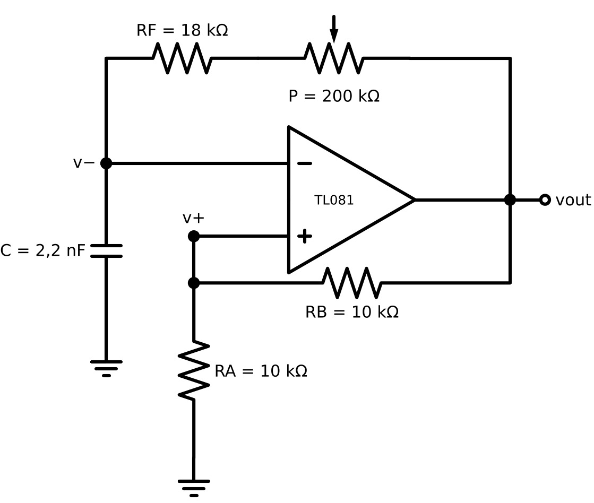
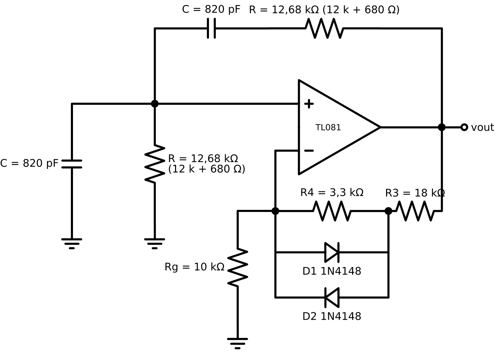

# Explicação dos Circuitos – Circuitos Eletrônicos (2ª Etapa, 2026.2)

> **Finalidade:** explicar, passo a passo e componente por componente, o que cada um dos três circuitos faz e por quê, a partir dos esquemáticos do projeto. No fim de cada circuito há a seção **"Intenção do circuito e o que esperar da simulação"**, que descreve o comportamento esperado em termos de ideia (o que deve ser visto), e não de conta. Ela serve para conferir se o circuito simulado faz o que se propõe.
> **Documentos relacionados:** `spec.md` (enunciado) e `calculos.md` (cálculos e critérios numéricos).

**Observação geral sobre os esquemáticos**
- Os três desenhos **não mostram a alimentação** do amp-op. Todos os TL081 são alimentados com **±15 V** (pino V+ em +15 V, pino V− em −15 V, referência no terra). Na simulação essas fontes precisam ser incluídas.
- Todos os símbolos de terra são o mesmo nó (0 V), que é também o ponto médio da fonte simétrica.
- O amp-op usado nos três é o **TL081**: entrada JFET (corrente de entrada praticamente nula), saída que satura em cerca de ±13,5 V com ±15 V, slew rate de 13 V/µs e produto ganho-banda de 3 MHz.

---

## 1. Filtro passa-baixa Butterworth de 3ª ordem (fc = 5 kHz, ganho de 26 dB)

### 1.1 Visão geral

O circuito é formado por **dois estágios em cascata** (a saída do primeiro alimenta a entrada do segundo):

| Estágio | O que é | Polos | Inclinação | Ganho |
|---|---|---|---|---|
| 1ª seção | Filtro RC de 1 polo + amplificador não inversor | 1 | 20 dB/déc | 10 V/V (20 dB) |
| 2ª seção | Filtro Sallen-Key de 2 polos (componentes iguais) | 2 | 40 dB/déc | 2 V/V (6 dB) |
| **Total** | **Butterworth de 3ª ordem** | **3** | **60 dB/déc** | **20 V/V (26 dB)** |

O sinal entra por `vin` (à esquerda) e sai por `vout` (à direita).

### 1.2 Percurso do sinal, componente por componente

**1ª seção (TL081 da esquerda)**

1. **R = 6,8 kΩ (série, na entrada).** Liga `vin` ao nó da entrada **não inversora (+)** do primeiro amp-op.
2. **C = 4,7 nF (do nó + para o terra).** Junto com o resistor anterior forma um **divisor RC passa-baixa**:
   - Em baixa frequência o capacitor é quase um circuito aberto, e a tensão no pino + é praticamente igual a `vin`.
   - Conforme a frequência aumenta, a reatância do capacitor (1/2πfC) diminui e ele "puxa" o sinal para o terra. A tensão no pino + cai.
   - A frequência em que a reatância do C se iguala a R é a frequência de corte, fc = 1/(2πRC) ≈ 4,98 kHz. Nela o sinal cai para 70,7 % (−3 dB).
   - Acima de fc, cada vez que a frequência multiplica por 10, o sinal cai 10 vezes (−20 dB/década). Esse é o **1º polo**.
3. **TL081 (1ª seção), configuração não inversora.** O amp-op recebe o sinal já filtrado no pino + e o **amplifica sem inverter a fase**. Como a entrada do TL081 é JFET, ele não consome corrente do nó RC, então não "carrega" o filtro.
4. **R1 = 18 kΩ (da saída para a entrada −)** e **R2 = 2 kΩ (da entrada − para o terra).** Formam o **divisor de realimentação negativa**:
   - O amp-op ajusta a saída para que a tensão no pino − (uma fração da saída, R2/(R1+R2) = 1/10) fique igual à do pino +.
   - Por isso a saída é 10 vezes a tensão do pino +: **ganho = 1 + R1/R2 = 1 + 18/2 = 10**.
   - Este estágio fornece **20 dB** dos 26 dB pedidos.
5. **Saída da 1ª seção.** É o sinal de entrada, amplificado 10 vezes e com um polo de filtragem. Ele segue para a 2ª seção.

**2ª seção (TL081 da direita): Sallen-Key**

6. **Primeiro R = 6,8 kΩ (série).** Liga a saída da 1ª seção ao **nó intermediário** (o nó entre os dois resistores, onde chega o capacitor de cima).
7. **Segundo R = 6,8 kΩ (série).** Liga o nó intermediário ao **pino + do segundo amp-op**.
8. **C = 4,7 nF (do pino + para o terra).** Com o segundo resistor, forma mais uma rede RC passa-baixa até o pino +.
9. **C = 4,7 nF (de cima, do nó intermediário até `vout`).** É o **capacitor de realimentação positiva**, a peça característica do Sallen-Key:
   - Em baixa frequência ele é praticamente aberto e não influencia.
   - Perto de fc ele devolve ao nó intermediário uma parte do sinal da saída. Esse "empurrão" compensa a queda suave que duas redes RC em sequência teriam, e deixa o "joelho" da curva mais definido.
   - A intensidade desse efeito é controlada pelo ganho do amp-op (ver item 11).
10. **TL081 (2ª seção), não inversor.** Igual ao primeiro: entrada pelo pino +, sem inverter.
11. **R1 = 10 kΩ e R2 = 10 kΩ.** Divisor de realimentação negativa com razão 1/2, então **ganho = 1 + 10/10 = 2** (6 dB). Esse valor **não é livre**:
    - No Sallen-Key de componentes iguais, o ganho define o fator de qualidade da seção, Q = 1/(3 − ganho).
    - O filtro Butterworth de 3ª ordem exige Q = 1 no par de polos, e isso só acontece com ganho exatamente 2.
    - Com ganho menor, a curva fica "arredondada", caindo antes de fc. Com ganho maior, surge um pico (ressonância) perto de fc. Com ganho 3, a seção vira um oscilador.
12. **Saída `vout`.** O sinal sai amplificado 20 vezes (10 × 2) na faixa de passagem, com 3 polos de filtragem.

### 1.3 Por que a combinação dá um Butterworth

- A 1ª seção sozinha já cai 3 dB em fc.
- A 2ª seção, com Q = 1, tem em fc exatamente o mesmo ganho que tem em baixa frequência: o "empurrão" do capacitor de realimentação compensa a queda.
- Somadas, a curva fica **plana até perto de fc**, cai **3 dB exatos em fc** e depois desce a **60 dB/década**.
- Essa é a resposta "maximamente plana" que define o filtro Butterworth: nenhuma ondulação na faixa de passagem e a transição mais reta possível sem criar pico.

### 1.4 Detalhes de projeto visíveis no esquema

- **R e C iguais nas três redes RC** (6,8 kΩ e 4,7 nF): as duas seções têm a mesma frequência de corte. Isso simplifica o projeto e é a premissa do Sallen-Key de componentes iguais.
- **Os dois amp-ops são não inversores:** o sinal não troca de sinal em nenhum estágio, então em baixa frequência a saída está em fase com a entrada.
- **Ganho dividido 10 × 2:** a 2ª seção tem ganho preso em 2 (item 11), então todo o resto do ganho pedido fica na 1ª seção, onde é livre.
- **Entrada JFET do TL081:** os amp-ops funcionam como "buffers" que não interferem nas redes RC.

### 1.5 Intenção do circuito e o que esperar da simulação

**Intenção:** deixar passar e **amplificar 20 vezes** todo sinal de frequência baixa (até cerca de 5 kHz) e **eliminar progressivamente** o que estiver acima, com um corte bem "afiado". É o que se usa, por exemplo, para limpar ruído de alta frequência de um sinal de áudio ou de sensor.

**O que deve ser visto:**

1. **Curva de resposta em frequência (Bode)**
   - Uma **reta horizontal** em cerca de 26 dB nas baixas frequências, plana até perto de 5 kHz e **sem nenhum pico** antes do joelho. Um pico indicaria Q acima de 1, isto é, ganho da 2ª seção maior que 2.
   - O joelho em cerca de 5 kHz, onde o ganho cai 3 dB (para ≈ 23 dB).
   - Depois do joelho, uma **descida reta e íngreme**: a cada década, o sinal fica 1000 vezes menor (−60 dB).
2. **Teste no tempo com senoides** (entrada de 0,5 V de pico)
   - **1 kHz:** a saída é uma senoide de cerca de **10 V de pico**, limpa, praticamente em fase com a entrada.
   - **5 kHz:** a saída cai para cerca de **7 V de pico** (70 %) e aparece atrasada em relação à entrada (cerca de −135°).
   - **10 kHz:** a saída fica pequena, em torno de **1,2 V de pico**.
   - **50 kHz:** a saída fica quase nula (alguns milivolts).
3. **Fase:** cerca de 0° em baixa frequência, −135° em fc e tendendo a −270° em alta frequência (−90° por polo).
4. **Nó intermediário (saída da 1ª seção):** em baixa frequência ele é 10 vezes a entrada, e a saída final é o dobro dele.

**Sinais de que algo está errado:**
- **Ganho em baixa frequência de 20 dB em vez de 26 dB:** a 2ª seção não está amplificando; o divisor de 10 kΩ/10 kΩ está mal ligado.
- **Pico perto de 5 kHz ou oscilação:** o capacitor de realimentação está ligado no lugar errado, ou as entradas + e − estão trocadas.
- **Inclinação de 20 ou 40 dB/déc:** falta um dos capacitores.
- **Saída ceifada (senoide achatada):** o sinal de entrada está acima de cerca de 0,67 V de pico.

---

## 2. Gerador de onda quadrada (multivibrador astável), 1 kHz a 10 kHz

### 2.1 Visão geral

O circuito é um **oscilador de relaxação**. O amp-op não trabalha como amplificador linear, e sim como **comparador com histerese** (Schmitt trigger). Ele tem duas realimentações:

| Realimentação | Componentes | Vai para | Papel |
|---|---|---|---|
| Positiva | RB e RA (divisor) | entrada **+** (`v+`) | Cria os dois limiares de comparação e "trava" a saída em +Vsat ou −Vsat |
| Negativa (RC) | RF + P e C | entrada **−** (`v−`) | É o "relógio": o capacitor carrega e descarrega, e o tempo disso define a frequência |

Não há sinal de entrada: o circuito **gera** o sinal sozinho e o entrega em `vout`.

### 2.2 Componente por componente

1. **TL081, como comparador.** A saída só tem dois estados:
   - Se v+ > v−, a saída vai para **+Vsat ≈ +13,5 V**.
   - Se v+ < v−, a saída vai para **−Vsat ≈ −13,5 V**.
   Não existe estado intermediário estável, porque a realimentação positiva empurra a saída para os extremos.
2. **RB = 10 kΩ (de `vout` para `v+`)** e **RA = 10 kΩ (de `v+` para o terra).** Formam um **divisor de tensão** que leva para a entrada + uma fração fixa da saída: β = RA/(RA+RB) = 0,5. Assim:
   - Com a saída em +13,5 V, a entrada + fica em **+6,75 V** (limiar superior).
   - Com a saída em −13,5 V, a entrada + fica em **−6,75 V** (limiar inferior).
   Essa é a **histerese**: o ponto de comparação muda conforme o estado da saída, o que evita trocas indecisas e dá a "memória" do circuito.
3. **RF = 18 kΩ (fixo) em série com P = 200 kΩ (potenciômetro), da saída até `v−`.** É a resistência por onde o capacitor carrega, RT = RF + P.
   - **RF** garante uma resistência mínima mesmo com o potenciômetro em zero. Isso define a **frequência máxima** e protege a saída do amp-op.
   - **P** é o **controle de frequência**. Mais resistência faz o capacitor carregar mais devagar, o que dá frequência menor.
   - O potenciômetro é usado como **resistor variável (reostato)**: o cursor (a seta no desenho) deve ficar ligado a uma das extremidades.
4. **C = 2,2 nF (de `v−` para o terra).** É o **elemento de temporização**. A tensão sobre ele é a tensão da entrada −.

### 2.3 Funcionamento, passo a passo (um ciclo completo)

1. **Estado A, saída em +13,5 V.** A entrada + está em +6,75 V. O capacitor carrega através de RF + P, e sua tensão (`v−`) sobe exponencialmente em direção a +13,5 V.
2. **Primeira troca.** Quando `v−` alcança **+6,75 V**, a entrada − fica maior que a +, e o comparador **inverte a saída para −13,5 V**. A troca é imediata (limitada só pelo slew rate). A realimentação positiva reforça a troca: ao cair a saída, a entrada + cai junto para −6,75 V.
3. **Estado B, saída em −13,5 V.** A entrada + agora está em −6,75 V. O capacitor descarrega pelo mesmo resistor, e `v−` desce de +6,75 V em direção a −13,5 V.
4. **Segunda troca.** Quando `v−` alcança **−6,75 V**, a saída volta para +13,5 V e a entrada + volta a +6,75 V.
5. O ciclo se repete indefinidamente.

**Resultado:**
- **Em `vout`:** uma **onda quadrada** de ±13,5 V.
- **Em `v−` (no capacitor):** uma onda em "dente arredondado", com trechos de exponencial subindo e descendo entre −6,75 V e +6,75 V.
- **Ciclo de trabalho de 50 %:** a carga e a descarga usam o mesmo resistor e percorrem a mesma diferença de tensão, então os tempos são iguais. A onda é simétrica.

### 2.4 Detalhes de projeto visíveis no esquema

- **RA = RB:** dá limiares simétricos (±6,75 V) e um período simples, T = 2·RT·C·ln 3 ≈ 2,2·RT·C.
- **RF de 18 kΩ, e não 20 kΩ:** cada troca do TL081 leva cerca de 2 µs (slew rate), e isso alonga o período. O RF menor compensa esse atraso para o circuito ainda alcançar 10 kHz.
- **P de 200 kΩ:** junto com RF, a resistência total varia de 18 kΩ a 218 kΩ, uma razão maior que 10. Isso cobre a década de 1 kHz a 10 kHz com folga nos dois extremos.
- **Por que o TL081:** num amp-op lento (como o 741), as trocas seriam tão lentas que a onda pareceria trapezoidal ou triangular a 10 kHz.

### 2.5 Intenção do circuito e o que esperar da simulação

**Intenção:** ser um **gerador de clock ajustável**, um oscilador que produz uma onda quadrada simétrica cuja frequência o usuário escolhe girando um potenciômetro, de cerca de 1 kHz até cerca de 10 kHz, sem nenhum sinal de entrada.

**O que deve ser visto:**

1. **Em `vout`:** uma onda quadrada com patamares retos em cerca de **+13,5 V e −13,5 V**, transições quase verticais (cerca de 2 µs) e tempos alto e baixo iguais.
2. **Em `v−` (capacitor):** uma onda que sobe e desce em **curvas exponenciais**, sempre entre −6,75 V e +6,75 V. Cada vez que a curva toca um desses limites, a onda quadrada troca de lado. Essa sincronia é a prova visual de que o circuito funciona como explicado.
3. **Em `v+`:** uma onda quadrada com metade da amplitude da saída (±6,75 V), em fase com ela.
4. **Efeito do potenciômetro:**
   - **P perto de 0:** cerca de **11 kHz**, um pouco acima de 10 kHz.
   - **P perto de 200 kΩ:** cerca de **950 Hz**, um pouco abaixo de 1 kHz.
   - A **amplitude não muda** com P, só a largura dos pulsos. A tensão no capacitor também continua entre ±6,75 V; só muda a velocidade com que ela vai de um limite ao outro.
5. **Partida:** na simulação o circuito pode precisar de um pequeno "empurrão" inicial (ruído ou condição inicial) para sair do equilíbrio em 0 V. No circuito real, o próprio ruído faz isso.

**Sinais de que algo está errado:**
- **Saída parada em +13,5 V ou −13,5 V:** as entradas + e − estão trocadas (o circuito vira uma trava), ou o capacitor não está ligado.
- **Saída senoidal ou travada em 0 V:** a realimentação positiva (RA/RB) está ausente ou foi ligada na entrada −.
- **Ciclo de trabalho longe de 50 %:** o circuito está assimétrico (por exemplo, ±Vsat desiguais por causa da alimentação).
- **Frequência que não muda com P:** o potenciômetro está mal ligado, com o cursor solto.

---

## 3. Oscilador senoidal em ponte de Wien (15 kHz)

### 3.1 Visão geral

O circuito é formado por um **amplificador não inversor** com uma **rede seletiva de frequência** (a ponte de Wien) ligando sua saída de volta à sua própria entrada +. Há duas realimentações:

| Realimentação | Componentes | Vai para | Papel |
|---|---|---|---|
| Positiva (seletiva) | Rede de Wien: R + C em série; R ∥ C para o terra | entrada **+** | Escolhe **qual frequência** oscila (15 kHz) |
| Negativa (ganho) | R3, R4, Rg e diodos D1 e D2 | entrada **−** | Define o **ganho** (cerca de 3) e **limita a amplitude** |

Novamente não há sinal de entrada: a oscilação nasce do próprio circuito.

### 3.2 Componente por componente

**Rede de Wien (realimentação positiva, parte de cima e da esquerda)**

1. **Ramo série: R = 12,68 kΩ (12 kΩ + 680 Ω) em série com C = 820 pF.** Vai de `vout` até o nó da entrada +.
   - O capacitor em série **bloqueia baixas frequências**: em frequência baixa sua reatância é enorme e quase nada passa.
2. **Ramo paralelo: R = 12,68 kΩ e C = 820 pF, os dois do nó + para o terra.**
   - O capacitor em paralelo **curto-circuita altas frequências** para o terra.
3. **Juntos, os dois ramos formam um filtro passa-faixa:**
   - Frequência baixa: o ramo série bloqueia.
   - Frequência alta: o ramo paralelo desvia para o terra.
   - **Só uma frequência, f0 = 1/(2πRC), passa "redonda"**: com fase exatamente 0° (o sinal no pino + fica em fase com a saída) e com amplitude de **1/3 da saída**.
   - Em qualquer outra frequência a rede atrasa ou adianta a fase e atenua mais.
4. **Por que 12,68 kΩ e não o valor "ideal" de 12,94 kΩ:** o TL081 atrasa um pouco a fase em 15 kHz (por causa do produto ganho-banda finito), e o circuito oscilaria cerca de 2 % abaixo do desejado. O R menor sobe a frequência da rede para compensar esse atraso. Como 12,68 kΩ não existe como valor comercial único, ele é obtido com 12 kΩ + 680 Ω em série, nos **dois** braços.

**Amplificador e controle de ganho (realimentação negativa, parte de baixo)**

5. **TL081, não inversor.** Recebe no pino + o sinal filtrado pela ponte e amplifica sem inverter.
6. **Rg = 10 kΩ (da entrada − para o terra).**
7. **R3 = 18 kΩ (de `vout` até o nó entre R3 e R4)** e **R4 = 3,3 kΩ (desse nó até a entrada −).** Em série, R3 + R4 é o resistor de realimentação, e o ganho é 1 + (R3 + R4)/Rg.
8. **D1 e D2 (1N4148), em antiparalelo e ligados em paralelo com R4.**
   - Os dois diodos estão em sentidos opostos: D1 conduz quando a tensão sobre R4 é positiva, e D2 quando é negativa. Assim os dois semiciclos são tratados igualmente.
   - **Sinal pequeno:** a tensão sobre R4 fica abaixo de cerca de 0,6 V, os diodos não conduzem e R4 conta inteiro. O ganho vale **1 + (18 + 3,3)/10 = 3,13**, um pouco acima de 3.
   - **Sinal grande:** nos picos a tensão sobre R4 passa de cerca de 0,6 V, os diodos conduzem e "curto-circuitam" R4. O ganho cai para perto de **1 + 18/10 = 2,8**, abaixo de 3.

### 3.3 Funcionamento, passo a passo

1. **Condição para oscilar (critério de Barkhausen).** O sinal precisa dar a volta completa no laço (amplificador e rede de Wien) e voltar **igual**: mesma fase e mesma amplitude. A rede devolve 1/3 do sinal em fase só em f0, então o amplificador precisa ter **ganho exatamente 3**. Nenhuma outra frequência satisfaz isso.
2. **Partida.** Ao ligar, há só ruído elétrico, que contém todas as frequências. A rede de Wien deixa "dar a volta" principalmente a componente de 15 kHz. Como o ganho em sinal pequeno é 3,13 (maior que 3), a cada volta essa componente fica cerca de 4 % maior. A senoide **cresce** a partir do nada.
3. **Crescimento.** A amplitude aumenta ciclo a ciclo, exponencialmente.
4. **Estabilização.** Quando a amplitude fica grande o bastante para os diodos começarem a conduzir nos picos, o ganho efetivo cai. A amplitude para de crescer no ponto em que o ganho **médio** ao longo do ciclo vale exatamente 3.
   - Se a amplitude diminuir um pouco, os diodos conduzem menos, o ganho sobe e ela volta a crescer.
   - Se aumentar, os diodos conduzem mais, o ganho cai e ela volta a diminuir.
   É um **controle automático de amplitude**.
5. **Regime permanente.** A saída é uma **senoide estável de cerca de 15 kHz e cerca de 9 V de pico**, bem abaixo da saturação (13,5 V). Por isso ela não é ceifada.

### 3.4 Detalhes de projeto visíveis no esquema

- **R e C iguais nos dois braços da ponte:** é o que faz a rede atenuar exatamente 3 vezes e ter fase zero em f0 = 1/(2πRC).
- **R4 pequeno em relação a R3:** a folga de ganho é só de cerca de 4 %. É suficiente para partir, mas pequena, o que mantém a distorção baixa. Se a folga fosse grande, os diodos teriam de "trabalhar muito" e a senoide sairia mais deformada.
- **Diodos sobre R4, e não sobre toda a realimentação:** eles reduzem o ganho de forma suave, em vez de ceifar a saída diretamente.
- **TL081:** a 15 kHz e 9 V de pico o slew rate exigido (≈ 0,85 V/µs) é muito menor que o disponível (13 V/µs), então a senoide não é deformada por velocidade.

### 3.5 Intenção do circuito e o que esperar da simulação

**Intenção:** ser um **gerador de senoide pura** em uma frequência fixa (15 kHz), que **parte sozinho** e **mantém a amplitude estável** sem saturar. A rede de Wien escolhe a frequência; os diodos fazem o papel de um "regulador automático de volume".

**O que deve ser visto:**

1. **Partida (visão de alguns milissegundos):**
   - No início a saída é praticamente zero.
   - Depois surge uma oscilação minúscula que **cresce em envelope exponencial**, como um "funil" que se abre.
   - Em cerca de 1 a 2 ms a amplitude para de crescer e fica **constante**.
   - O envelope deve ficar estável: sem continuar crescendo, sem encolher e sem "pulsar".
2. **Regime (zoom de poucos ciclos):**
   - Uma **senoide** de cerca de **15 kHz** (período de cerca de 67 µs), com picos de cerca de **±9 V**, simétrica nos semiciclos positivo e negativo.
   - Os picos devem ser **arredondados**, não achatados.
   - Uma deformação leve é normal (distorção de poucos %, vinda dos diodos).
3. **Nó + (saída da rede de Wien):** uma senoide **em fase com a saída** e com cerca de **1/3 da amplitude** (≈ 3 V de pico). Essa é a confirmação direta do critério de Barkhausen.
4. **Nó entre R3 e R4:** sobre R4 a tensão fica limitada a cerca de ±0,6 V nos picos, onde os diodos conduzem.
5. **FFT da saída:** um pico dominante em 15 kHz e harmônicas bem menores (2ª, 3ª), confirmando que a onda é quase senoidal.
6. **Comparação didática (opcional):** com R = 13 kΩ (sem a compensação), a frequência cai para cerca de 14,6 kHz. Isso mostra o efeito do amp-op real e justifica o uso de 12 kΩ + 680 Ω.

**Sinais de que algo está errado:**
- **A oscilação não parte (saída fica em 0 V):** o ganho em sinal pequeno está abaixo de 3 (R4 em curto, Rg grande demais ou entradas trocadas), ou os componentes da ponte não estão iguais.
- **Senoide com picos achatados em ±13,5 V:** os diodos estão ausentes ou ligados de forma que não conduzem (os dois no mesmo sentido, por exemplo). O ganho fica sempre acima de 3 e a saída satura.
- **Amplitude encolhendo até sumir:** o ganho está abaixo de 3 o tempo todo.
- **Frequência muito diferente de 15 kHz:** R ou C da ponte estão errados (kΩ × Ω, pF × nF), ou o ramo série e o ramo paralelo foram trocados.
- **Semiciclos de amplitudes diferentes:** um dos diodos está faltando.

---

## 4. Resumo das intenções

| Circuito | Faz o quê | Prova visual principal na simulação |
|---|---|---|
| 1. Filtro Butterworth | Amplifica 20× o que está abaixo de 5 kHz e elimina o que está acima, com corte de 60 dB/déc | Bode plano em 26 dB, sem pico, joelho em 5 kHz (−3 dB) e descida reta e íngreme |
| 2. Gerador de onda quadrada | Gera sozinho uma onda quadrada simétrica de ±13,5 V com frequência ajustável de 1 kHz a 10 kHz | Onda quadrada em `vout` trocando de lado exatamente quando a exponencial do capacitor toca ±6,75 V; P muda só a frequência |
| 3. Oscilador de Wien | Gera sozinho uma senoide de 15 kHz com amplitude estável, sem saturar | Envelope que cresce e estabiliza; senoide limpa de cerca de 9 V de pico; nó + com 1/3 da saída e em fase |