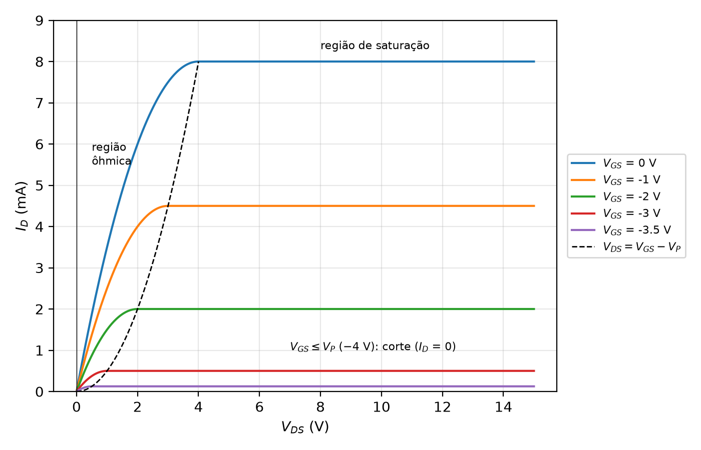
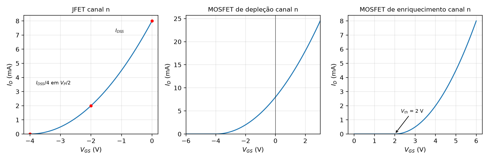
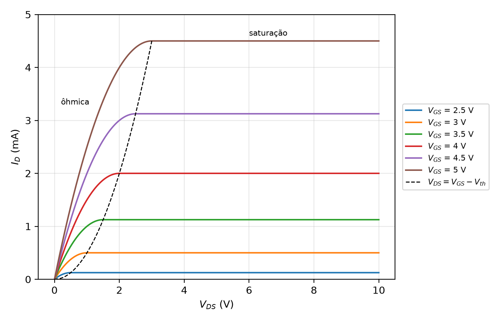
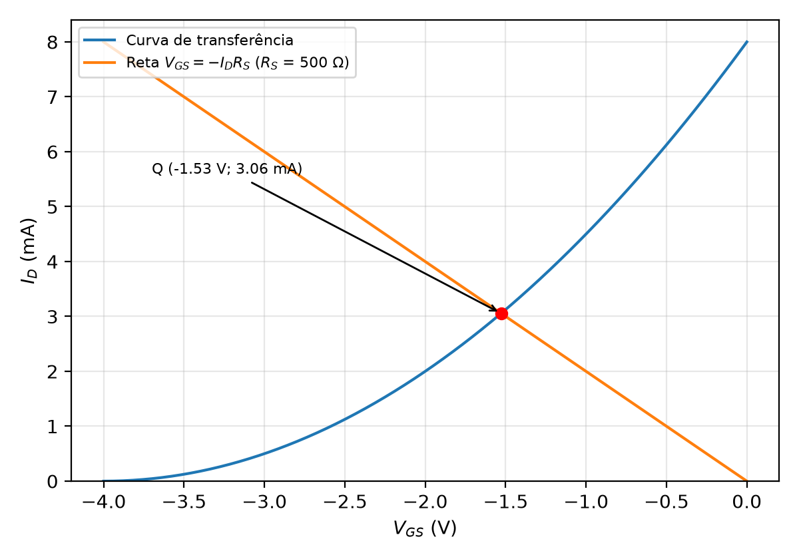

# 6 PESQUISA TEÓRICA: TRANSISTOR A EFEITO DE CAMPO (FET)

## 6.1 Classificação

O transistor a efeito de campo (*Field-Effect Transistor*, FET) é um dispositivo de três terminais, **porta** (G), **dreno** (D) e **fonte** (S), em que a corrente de dreno I_D é controlada pelo campo elétrico criado pela tensão porta-fonte V_GS. É, portanto, controlado por tensão, e unipolar: a condução depende de um único tipo de portador (BOYLESTAD; NASHELSKY, 2013). A corrente de porta é praticamente nula, o que resulta em impedância de entrada muito alta.

Os FETs se dividem em JFET (porta formada por junção pn polarizada reversamente) e MOSFET (porta isolada por óxido), este último de depleção ou de enriquecimento, todos com versões de canal n ou p. Nos dispositivos de canal p, as polaridades de V_GS e V_DS e o sentido de I_D se invertem; as equações a seguir são escritas para o canal n.

<!--Q: Comparação entre os tipos de FET de canal n-->
| Característica | JFET | MOSFET de depleção | MOSFET de enriquecimento |
|---|---|---|---|
| Isolação da porta | Junção pn reversa | Óxido | Óxido |
| Canal com V_GS = 0 | Existe (I_D = I_DSS) | Existe (I_D = I_DSS) | Não existe (I_D = 0) |
| V_GS em operação | Negativa, de 0 a V_P | Negativa ou positiva | Positiva, acima de V_th |
| Parâmetros | I_DSS, V_P | I_DSS, V_P | k, V_th |
Fonte: Elaborado pelos autores (2026), com base em Boylestad e Nashelsky (2013).

## 6.2 Caracterização e curvas características

### 6.2.1 JFET: estrutura e funcionamento

O JFET de canal n é uma barra de silício tipo n (o canal), com dreno e fonte nas extremidades e duas regiões tipo p (a porta) nas laterais. A junção porta-canal opera sempre em polarização reversa, de modo que I_G ≈ 0.

Com V_GS = 0 e V_DS pequeno, o canal está aberto e o dispositivo se comporta como um resistor. Ao aumentar V_DS, a queda de tensão ao longo do canal alarga a região de depleção junto ao dreno e o canal se estrangula; quando V_DS = V_GS − V_P, a corrente deixa de crescer com V_DS e o dispositivo entra em saturação. Uma V_GS negativa alarga a depleção em todo o canal e reduz a corrente; em V_GS = V_P (negativa no canal n) o canal se fecha e I_D = 0 (corte).

### 6.2.2 Curvas de dreno e regiões de operação

A curva de dreno mostra I_D em função de V_DS para vários valores de V_GS ({fig:fet_jfet_dreno}). O JFET opera em quatro regiões:

<!--Q: Regiões de operação do JFET de canal n-->
| Região | Condição | Comportamento |
|---|---|---|
| Corte | V_GS ≤ V_P | I_D ≈ 0 |
| Ôhmica (triodo) | V_GS > V_P e V_DS < V_GS − V_P | Resistor controlado por V_GS |
| Saturação | V_GS > V_P e V_DS ≥ V_GS − V_P | I_D controlada por V_GS; região de amplificação |
| Ruptura | V_DS muito alto | Avalanche da junção; deve ser evitada |
Fonte: Elaborado pelos autores (2026), com base em Boylestad e Nashelsky (2013).

Na saturação vale a equação de Shockley, em que I_DSS é a corrente de dreno com V_GS = 0 e V_P < 0 é a tensão de estrangulamento:

$$[shockley] I_D = I_{DSS}\left(1-\frac{V_{GS}}{V_P}\right)^2$$

Na região ôhmica:

$$[ohmica] I_D = \frac{I_{DSS}}{V_P^2}\left[2\,(V_{GS}-V_P)\,V_{DS}-V_{DS}^2\right]$$

As Equações {eq:shockley} e {eq:ohmica} coincidem em V_DS = V_GS − V_P, fronteira entre as regiões (linha tracejada na {fig:fet_jfet_dreno}). Para V_DS pequeno, a resistência do canal cresce quando V_GS se aproxima de V_P. No modelo ideal a corrente é constante na saturação; nos dispositivos reais ela cresce levemente com V_DS, efeito representado pela resistência de saída r_o.

Fonte: Elaborada pelos autores (2026), a partir das Equações {eq:shockley} e {eq:ohmica}.

### 6.2.3 Curva de transferência

A curva de transferência (I_D × V_GS) é a própria Equação {eq:shockley}: uma parábola que vai de I_DSS, em V_GS = 0, até zero, em V_GS = V_P. Em V_GS = V_P/2 a corrente é I_DSS/4. A {fig:fet_transferencia} mostra a curva do JFET e as dos MOSFETs.

### 6.2.4 MOSFET

O **MOSFET de depleção** tem a mesma curva de transferência do JFET, mas, como a porta é isolada, V_GS pode ser positiva sem corrente de porta; a curva se estende além de I_DSS.

O **MOSFET de enriquecimento** não tem canal com V_GS = 0. Acima da tensão de limiar V_th, forma-se um canal induzido. Em saturação (V_DS ≥ V_GS − V_th) e na região ôhmica (V_DS < V_GS − V_th), a corrente é:

$$[sat_enh] I_D = k\,(V_{GS}-V_{th})^2$$

$$[ohm_enh] I_D = k\left[2\,(V_{GS}-V_{th})\,V_{DS}-V_{DS}^2\right]$$

onde k = ½·μ_n·C_ox·(W/L) é o parâmetro de transcondutância, em A/V² (SEDRA; SMITH, 2007). As curvas de dreno estão na {fig:fet_emosfet_dreno}.

Fonte: Elaborada pelos autores (2026).

Fonte: Elaborada pelos autores (2026), a partir das Equações {eq:sat_enh} e {eq:ohm_enh}.

### 6.2.5 Parâmetros de pequenos sinais

Na saturação, o FET é caracterizado pela transcondutância g_m = ∂I_D/∂V_GS e pela resistência de saída r_o = ΔV_DS/ΔI_D. Para o JFET e o MOSFET de depleção, e para o MOSFET de enriquecimento, respectivamente:

$$[gm_jfet] g_m = \frac{2I_{DSS}}{|V_P|}\left(1-\frac{V_{GS}}{V_P}\right)$$

$$[gm_mos] g_m = 2k\,(V_{GS}-V_{th})$$

## 6.3 Polarização e amplificação

### 6.3.1 Polarização

Polarizar é fixar o ponto de operação Q (I_DQ, V_GSQ, V_DSQ) com o transistor na região de saturação. Como I_G ≈ 0, o ponto Q é a interseção da curva de transferência com a reta de polarização do circuito. Depois de obter I_D, calcula-se V_DS e verifica-se se V_DS ≥ V_GS − V_P (ou V_th). As formas usuais são:

- **Polarização fixa (JFET):** uma fonte V_GG negativa impõe V_GS = −V_GG. É simples, mas exige duas fontes e o ponto Q varia muito com a dispersão de I_DSS e V_P.
- **Autopolarização (JFET e MOSFET de depleção):** um resistor R_S na fonte, com a porta a 0 V por R_G, gera V_GS = −I_D·R_S. Substituindo na Equação {eq:shockley} obtém-se a equação do 2º grau a seguir, e adota-se a raiz com |V_GS| < |V_P|. A solução gráfica é a interseção da curva de transferência com a reta I_D = −V_GS/R_S ({fig:fet_polarizacao}).
- **Divisor de tensão (todos os tipos):** R_1 e R_2 fixam V_G = V_DD·R_2/(R_1 + R_2) e V_GS = V_G − I_D·R_S. A reta de polarização não passa pela origem e, quanto maior R_S, menos I_D varia com a dispersão dos parâmetros, o que torna este o esquema mais estável. No MOSFET de enriquecimento, I_D = k·V_ov², com V_ov dado pela Equação {eq:vov_div}.
- **Realimentação de dreno (MOSFET de enriquecimento):** R_G liga o dreno à porta; sem queda em R_G, V_GS = V_DS = V_DD − I_D·R_D, o que mantém o transistor em saturação. V_ov é dado pela Equação {eq:vov_fb}.

$$[auto_quad] \frac{I_{DSS}R_S^2}{V_P^2}\,I_D^2-\left(\frac{2I_{DSS}R_S}{|V_P|}+1\right)I_D+I_{DSS}=0$$

$$[vov_div] V_{ov}=V_{GS}-V_{th}=\frac{-1+\sqrt{1+4kR_S\,(V_G-V_{th})}}{2kR_S}$$

$$[vov_fb] V_{ov}=\frac{-1+\sqrt{1+4kR_D\,(V_{DD}-V_{th})}}{2kR_D}$$

Fonte: Elaborada pelos autores (2026).

**Exemplo 1 – JFET autopolarizado.** Com I_DSS = 8 mA, V_P = −4 V, V_DD = 20 V, R_S = 500 Ω e R_D = 3,3 kΩ, a Equação {eq:auto_quad} fica 0,125·I_D² − 3·I_D + 8 = 0 (I_D em mA), com raízes 3,056 mA e 20,94 mA; a segunda dá |V_GS| > |V_P| e é descartada. Resulta I_D = 3,06 mA, V_GS = −1,53 V e V_DS = 20 − 3,056 m·(3,3 k + 0,5 k) = 8,39 V. Como V_GS − V_P = 2,47 V ≤ V_DS, a saturação é confirmada.

### 6.3.2 Amplificação

Para pequenos sinais, o FET é uma fonte de corrente controlada por tensão, i_d = g_m·v_gs + v_ds/r_o, com a porta em circuito aberto; na análise CA, a fonte V_DD e os capacitores de acoplamento e de desvio são curtos. Os capacitores de acoplamento e de desvio definem a frequência de corte inferior, f_L ≈ 1/(2πRC). Com r_o muito maior que as cargas, as configurações básicas são as do quadro a seguir, em que Z_i e Z_o são as impedâncias de entrada e de saída:

<!--Q: Configurações básicas de amplificadores com FET-->
| Configuração | Entrada / saída | Ganho de tensão | Z_i | Z_o | Fase |
|---|---|---|---|---|---|
| Fonte comum, com R_S desviado | porta / dreno | −g_m·(R_D ∥ R_L ∥ r_o) | R_G (ou R_1 ∥ R_2) | R_D ∥ r_o | 180° |
| Fonte comum, sem desvio | porta / dreno | −g_m·(R_D ∥ R_L) / (1 + g_m·R_S) | R_G | ≈ R_D | 180° |
| Dreno comum (seguidor) | porta / fonte | g_m·R_S' / (1 + g_m·R_S'), com R_S' = R_S ∥ R_L | R_G | R_S ∥ (1/g_m) | 0° |
| Porta comum | fonte / dreno | g_m·(R_D ∥ R_L) | R_S ∥ (1/g_m) | ≈ R_D | 0° |
Fonte: Elaborado pelos autores (2026), com base em Boylestad e Nashelsky (2013) e Sedra e Smith (2007).

A fonte comum dá ganho de tensão com inversão de fase e Z_i alta; o dreno comum tem ganho próximo de 1, Z_i alta e Z_o baixa (*buffer*); a porta comum tem Z_i baixa e é usada em altas frequências.

**Exemplo 2 – Fonte comum (continuação do Exemplo 1).** No ponto Q, g_m = 2·8 m/4·(1 − 1,528/4) = 2,47 mS. Com R_S desviado, o ganho é ≈ −g_m·R_D = −2,47 m·3,3 k ≈ −8,2; sem o desvio, ≈ −8,16/(1 + 2,47 m·500) ≈ −3,6 (r_o e R_L desprezados).

## 6.4 Aplicações

As aplicações decorrem da impedância de entrada muito alta, do comportamento de resistor controlado por tensão na região ôhmica e da facilidade de operar como chave com acionamento por tensão.

<!--Q: Aplicações do FET-->
| Aplicação | Tipo de FET | Descrição |
|---|---|---|
| Estágio de entrada de amplificadores (instrumentação, osciloscópio, voltímetro eletrônico, microfone de eletreto) | JFET, MOSFET | A alta impedância de entrada não carrega a fonte do sinal; baixo ruído com fontes de alta impedância. |
| Seguidor de fonte (*buffer*) | JFET, MOSFET | Casa uma fonte de alta impedância com uma carga de baixa impedância. |
| Chave analógica (multiplexador, *sample-and-hold*) | JFET, MOSFET | Opera entre corte e região ôhmica, com baixa resistência em condução. |
| Resistor controlado por tensão (controle automático de ganho, atenuador) | JFET na região ôhmica | A resistência do canal varia com V_GS. |
| Fonte de corrente constante | JFET | Na saturação, I_D é quase independente de V_DS. |
| Chaveamento de potência (fontes chaveadas, acionamento de motores, PWM) | MOSFET de enriquecimento | Baixa resistência em condução, comutação rápida, acionamento por tensão. |
| Circuitos digitais CMOS (portas lógicas, memórias, microprocessadores) | MOSFET canal n e p complementares | Consumo estático muito baixo e alta densidade de integração. |
| Amplificadores de RF | JFET, MOSFET | Baixo ruído; configurações porta comum e *cascode*. |
Fonte: Elaborado pelos autores (2026), com base em Boylestad e Nashelsky (2013), Malvino e Bates (2016) e Sedra e Smith (2007).
