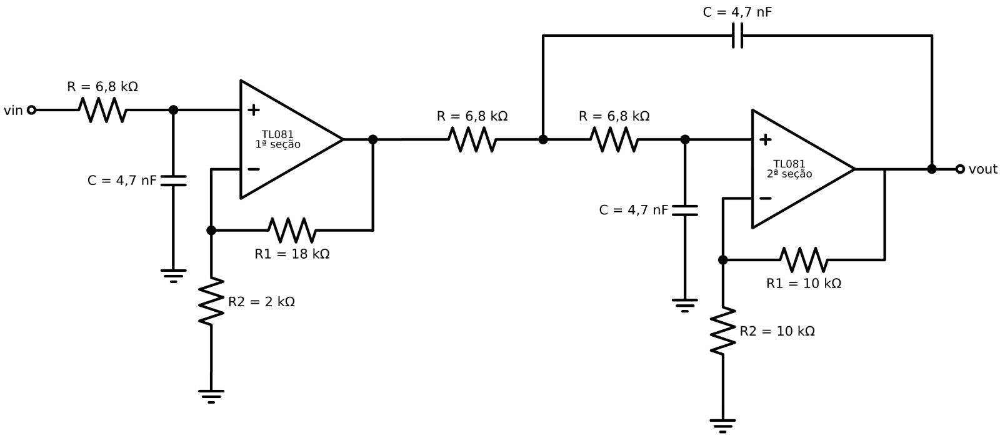
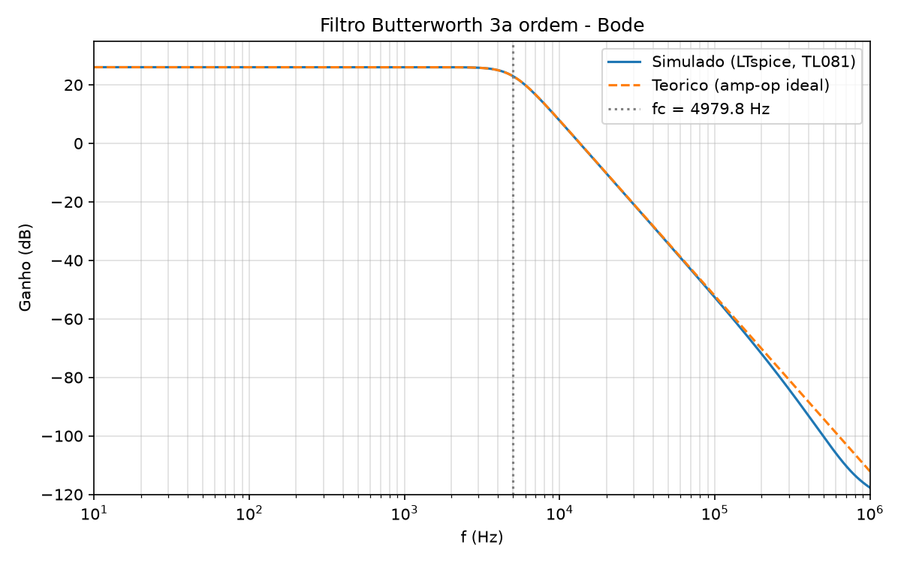
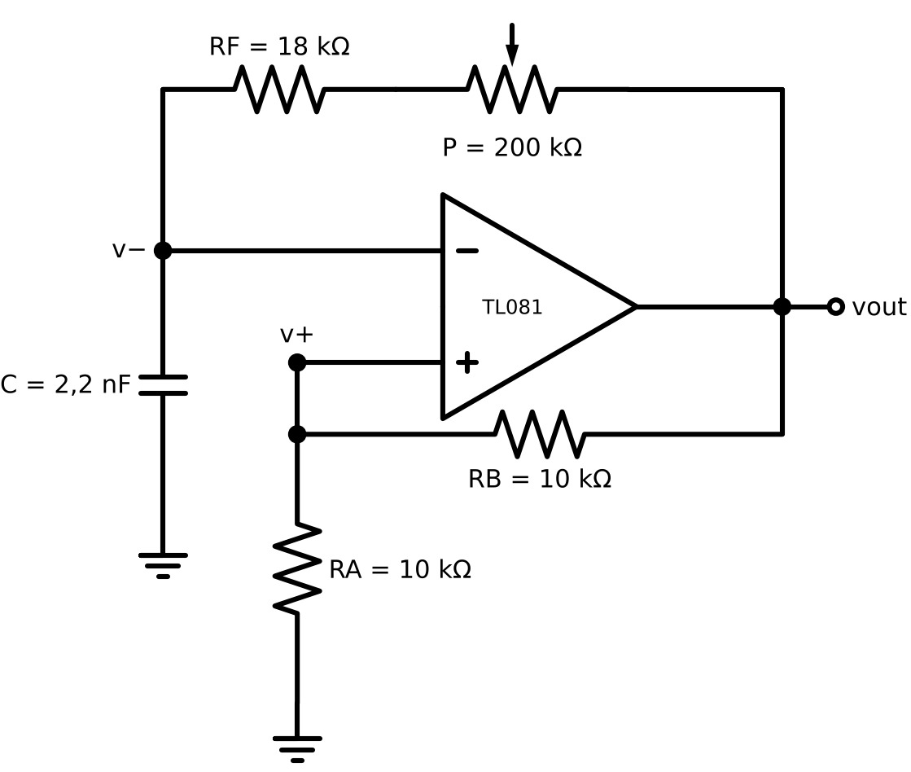
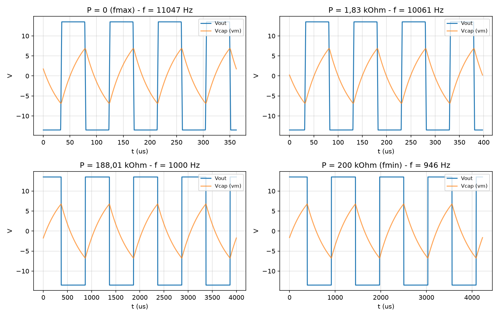
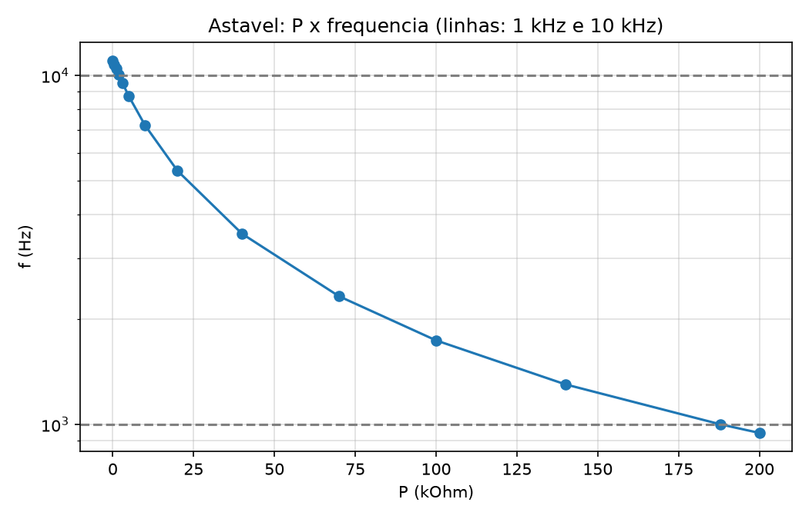
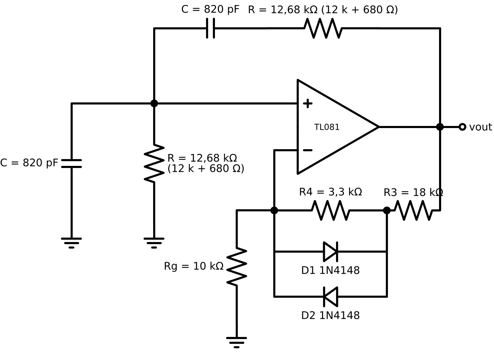
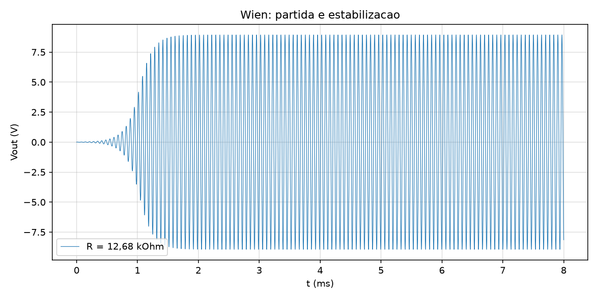
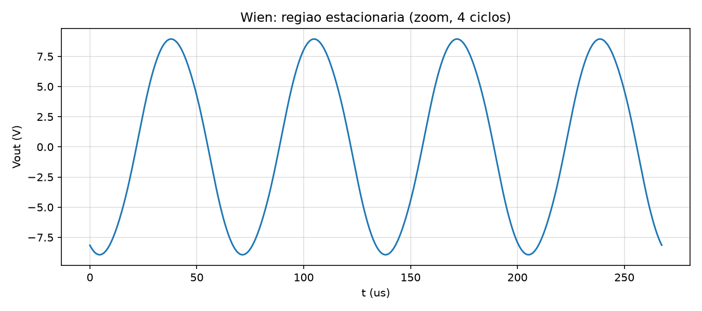
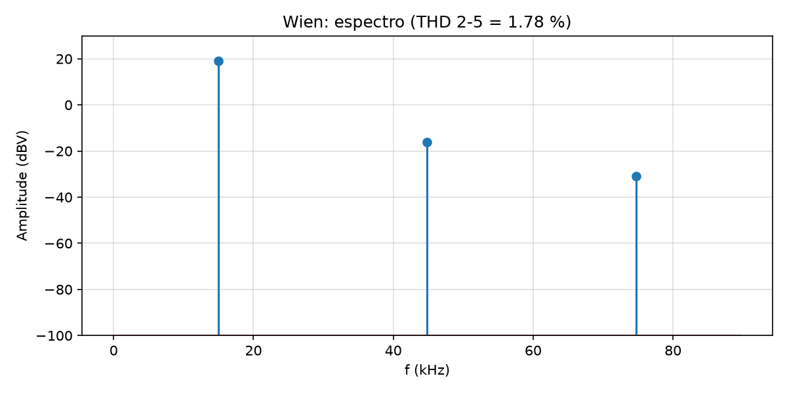
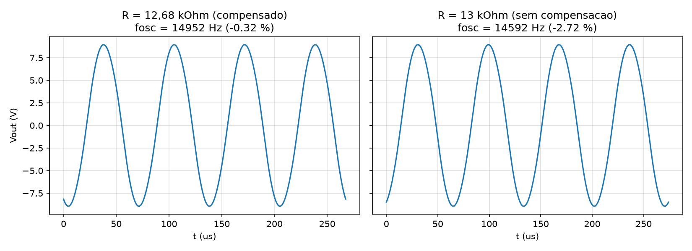

# Relatório – Simulação de Circuitos com Amplificador Operacional

**Disciplina:** Circuitos Eletrônicos – 2ª Etapa, semestre 2026.2 (1ª parte: simulação)
**Entrega:** 25 de novembro (relatório em PDF por e-mail, ou impresso no laboratório às 13:30 h)
**Equipe:** _(preencher com o nome de todos os integrantes, no máximo 6)_

**Projetos:**
1. Filtro passa-baixa Butterworth (fc = 5 kHz, 60 dB/déc, 26 dB)
2. Gerador de onda quadrada de 1 kHz a 10 kHz
3. Oscilador senoidal em ponte de Wien (15 kHz)

> Documentos de apoio: `spec.md` (enunciado), `calculos.md` (memorial de cálculo e critérios), `circuitos.md` (explicação dos circuitos). Código em `src/`, resultados em `output/`, esquemáticos em `docs/img/`.

---

## Sumário

0. Dados acrescentados ao projeto (e por quê)
1. Ferramentas e metodologia de simulação
2. Projeto 1 – Filtro Butterworth
3. Projeto 2 – Gerador de onda quadrada
4. Projeto 3 – Oscilador de Wien
5. Resumo geral dos resultados
6. Limitações e observações
7. Como reproduzir
8. Arquivos gerados

---

## 0. Dados acrescentados ao projeto (e por quê)

O enunciado pede que a equipe acrescente dados a cada projeto e **explique o porquê**. Estas foram as escolhas:

| Dado acrescentado | Valor adotado | Por quê |
|---|---|---|
| Amplificador operacional | **TL081** (entrada JFET) | Slew rate de 13 V/µs e GBW de 3 MHz (valores típicos do datasheet TI). O LM741 (0,5 V/µs) não gera onda quadrada limpa a 10 kHz com ±15 V: só a transição de −13,5 V a +13,5 V levaria 54 µs, mais que o semiperíodo de 50 µs. |
| Alimentação | **±15 V** simétrica | Tensão padrão de laboratório; o TL081 aceita até ±18 V. Saturação típica ≈ ±13,5 V (carga ≈ 10 kΩ). |
| Séries de componentes | Resistores **E24** (5 %), capacitores **E12** | Valores encontrados no comércio; permitem simular como seria na prática. As contas usam valores nominais. |
| Topologia do filtro | 1 polo (RC + não inversor) em cascata com 2 polos (Sallen-Key de componentes iguais) | A tabela de Butterworth fixa o ganho da seção de 2 polos em 2. |
| Ganho da 1ª seção do filtro | ≈ 10 V/V (20 dB) | O enunciado pede 26 dB; a 2ª seção dá 6,02 dB fixos; os 20 dB restantes ficam na 1ª seção, onde o ganho é livre. |
| Variação de frequência do gerador | Resistor fixo (RF) + potenciômetro (P) | Para varrer a década é preciso um elemento variável; f é inversamente proporcional à resistência. |
| Realimentação positiva do gerador | β = 0,5 (RA = RB = 10 kΩ) | Define os limiares do Schmitt (±6,75 V) e simplifica o período (ln 3). |
| Estabilização de amplitude da Wien | Diodos 1N4148 em antiparalelo com R4 | Sem isso a oscilação satura (onda ceifada) ou não parte. |

**Parâmetros do TL081 usados em todas as contas e simulações:** GBW = 3 MHz, slew rate = 13 V/µs, saturação ±13,5 V (Vcc − 1,5 V / Vee + 1,5 V) com ±15 V, faixa de modo comum mínima ±11 V, tensão diferencial máxima ±30 V.

**Observação geral sobre os esquemáticos:** os desenhos não mostram a alimentação; todos os TL081 usam +15 V / −15 V com referência no terra. Todos os símbolos de terra são o mesmo nó (0 V).

---

## 1. Ferramentas e metodologia de simulação

### 1.1 Ferramentas

| Item | Uso |
|---|---|
| **PySpice** | Só para **montar** os circuitos (`Circuit`, componentes, modelo de diodo) e gerar a netlist |
| **LTspice** (modo batch, `-b`) | Simulador (o enunciado admite "outro simulador de sua escolha") |
| **spicelib** | Leitura do arquivo `.raw` gerado pelo LTspice |
| **NumPy / Matplotlib** | Medidas (cruzamentos por zero, FFT, interpolação) e gráficos |
| **schemdraw** | Esquemáticos (`src/esquematicos.py`) |
| **uv** | Gerenciador do ambiente (Python ≥ 3.14, `pyproject.toml`) |

O backend nativo do PySpice não é usado (falha com ngspice ≥ 40 e NumPy ≥ 2). O fluxo é: PySpice monta a netlist → `ltspice_runner.py` grava o `.cir`, acrescenta a análise, roda o LTspice e lê o `.raw`.

### 1.2 Modelo do amplificador operacional (`src/tl081_behav.lib`)

Modelo comportamental, subcircuito `TL081B` com pinos `inp inn vcc vee out`:

- Entrada: `Rin` = 1 TΩ entre as entradas e 1 TΩ de cada entrada ao terra (entrada JFET, corrente praticamente nula).
- Estágio integrador: fonte de corrente `Bg` = `max(−imax, min(imax, gm·(V(inp) − V(inn))))` sobre `Rp` = 200 MΩ em paralelo com `Cp` = gm/(2π·GBW) ≈ 53,05 pF, com gm = 1 mS.
  - Ganho DC = gm·Rp = 2·10⁵ (≈ 106 dB); polo dominante em GBW/ganho DC; GBW = 3 MHz.
  - Slew rate = imax/Cp = 13 V/µs (o limite de corrente `imax` = SR·Cp).
- Grampos de saturação: fontes `Bp` = V(vcc) − 1,5 e `Bn` = V(vee) + 1,5, com diodos `Dp`/`Dn` (modelo `DCL`, IS = 10⁻¹⁴, N = 0,02) no nó interno, que evitam *windup* quando saturado. Saturação = ±13,5 V com ±15 V.
- Saída: `Eout` (ganho 1) com `Rout` = 1 Ω.

### 1.3 Alimentação e partida

- Fontes `Vcc` = +15 V e `Vee` = −15 V em todos os circuitos.
- **Partida dos osciladores (Projetos 2 e 3):** o equilíbrio em 0 V é instável; a simulação injeta um pulso de corrente `Ikick` (0 → 2 µA, atraso 0, subida/descida 10 ns, largura 1 µs) no nó `vp` (entrada +). Não se usa `.ic` + `uic`.

### 1.4 Análises e métodos de medida

| Projeto | Análise | Passo / pontos | Medidas |
|---|---|---|---|
| 1 | `.ac dec 200 10 1meg` (fonte `dc 0 ac 1`) | 200 pontos/década, 10 Hz a 1 MHz | Ganho em dB = 20·log₁₀\|V(out)\|, interpolado em escala log de f |
| 2 | `.tran 0 tmax 0 20n`, com tmax = 14/f_est e f_est = 1/(2,1972·(RF+P)·C) | passo máx. 20 ns, 14 períodos | Frequência, níveis, ciclo de trabalho |
| 3 | `.tran 0 8m 0 0.1u` | passo máx. 0,1 µs, 8 ms | Frequência, amplitude, THD, estabilização |

Detalhes das medidas:
- **Reamostragem:** o LTspice usa passo variável; o sinal é reamostrado em grade uniforme de 5 ns antes de medir.
- **Frequência:** média dos intervalos entre cruzamentos ascendentes por zero (interpolação linear). No astável ignoram-se os 2 primeiros períodos; na Wien usa-se a janela final de 1,5 ms.
- **Níveis alto/baixo:** máximo e mínimo do sinal na janela de medida.
- **Ciclo de trabalho (Projeto 2):** fração do tempo com V(out) > 0, calculada **sobre número inteiro de períodos** (entre o primeiro e o último cruzamento ascendente). Medir numa janela com número fracionário de períodos desloca o resultado em até ≈ 1 ponto percentual, sem relação com o circuito (versão anterior do script dava 51,2 %; corrigido, o valor é 50,00 %).
- **THD (Projeto 3):** a forma de onda é reamostrada em 20.000 pontos entre o primeiro e o último cruzamento ascendente da janela final (número inteiro de ciclos); na FFT as harmônicas caem exatamente nos bins k·k1. THD = √(Σ A_k², k = 2…5)/A₁.
- **Estabilização (Projeto 3):** variação relativa do pico nos últimos 1,5 ms em relação aos 1,5 ms anteriores (critério: < 5 %).

### 1.5 Critérios de aceitação

Definidos no memorial (`calculos.md`, seção 7) e aplicados automaticamente pelos scripts; cada linha das tabelas é marcada `OK`, `FALHOU` ou `info` (informativo, sem critério).

---

## 2. Projeto 1 – Filtro passa-baixa Butterworth (fc = 5 kHz, 60 dB/déc, 26 dB)



### 2.1 Especificação

- Tipo: Butterworth passa-baixa; fc = 5 kHz; inclinação 60 dB/década; ganho na faixa de passagem 26 dB.

### 2.2 Cálculos

**Ordem.** Cada polo dá 20 dB/déc, então n = 60/20 = **3 polos** (3ª ordem), divididos em 1ª seção (1 polo, 20 dB/déc) + 2ª seção (2 polos, 40 dB/déc).

**Ganho total.** Atotal = 10^(26/20) = 19,9526 V/V.

**2ª seção (Sallen-Key, R e C iguais).**
```
H2(s) = A2·ω0² / (s² + (3 − A2)·ω0·s + ω0²),  ω0 = 1/(RC),  Q = 1/(3 − A2)
Butterworth 3ª ordem: (s + 1)(s² + s + 1) ⇒ par de polos com Q = 1
1 = 1/(3 − A2) ⇒ A2 = 2 (= 6,02 dB) ⇒ R1 = R2 = 10 kΩ
```
O ganho da 2ª seção **não é livre**: com A2 < 2 a curva "arredonda" antes de fc; com A2 > 2 surge pico perto de fc; com A2 = 3 a seção oscila.

**1ª seção (RC + não inversor).**
```
A1 = Atotal/A2 = 19,9526/2 = 9,9763 ⇒ R1/R2 = 8,9763
R2 = 2 kΩ ⇒ R1 = 17,953 kΩ (teórico) → comercial 18 kΩ ⇒ A1 = 1 + 18/2 = 10
Ganho total real = 10 × 2 = 20 V/V = 26,0206 dB (erro 0,0206 dB; 0,24 % em V/V)
```

**Rede RC (as três iguais).**
```
fc = 1/(2πRC); C = 4,7 nF ⇒ R = 6.772,6 Ω → comercial 6,8 kΩ
fc real = 1/(2π × 6800 × 4,7·10⁻⁹) = 4.979,8 Hz (erro −0,40 %)
```
(4,7 nF com 6,8 kΩ é, entre as combinações E24/E12 com R de 1 kΩ a 100 kΩ, a de menor erro.)

**Resposta teórica (amp-op ideal).**
```
|H1|² = 1/(1 + x²);  |H2|² = 1/(1 − x² + x⁴);  produto = 1/(1 + x⁶),  x = f/fc
|H(f)| = Atotal/√(1 + (f/fc)⁶)    (Atotal = 20 V/V)
Em f = fc: 1ª seção −3,01 dB; 2ª seção 0 dB (Q = 1); total −3,01 dB
Fase em fc: −45° (1ª seção) − 90° (2ª seção) = −135°; tende a −270° em alta frequência
```

**Verificações com o TL081.**
- Banda da 1ª seção = GBW/A1 = 3 MHz/10 = 300 kHz (= 60·fc); da 2ª = 3 MHz/2 = 1,5 MHz.
- Slew rate exigido = 2π·fc·Vp = 2π × 5000 × 13,5 = 0,42 V/µs < 13 V/µs.
- Entrada máxima sem saturar = 13,5/20 = 0,675 V de pico (usar até ≈ 0,5 V).
- Nó intermediário: A1 × 0,675 = 6,75 V < Vsat.

### 2.3 Componentes e conexões

| Componente | Valor | Nó A | Nó B | Observação |
|---|---|---|---|---|
| Vin | `dc 0 ac 1` | `vin` | `0` | Fonte AC de 1 V (|Vout| = ganho em V/V) |
| R1a | 6,8 kΩ | `vin` | `a` | Rede RC da 1ª seção |
| C1a | 4,7 nF | `a` | `0` | |
| U1 (TL081) | — | `+` = `a`, `−` = `b` | saída `o1` | 1ª seção, não inversora |
| R1f | 18 kΩ | `o1` | `b` | Realimentação |
| R1g | 2 kΩ | `b` | `0` | |
| R2a | 6,8 kΩ | `o1` | `n3` | Sallen-Key |
| R2b | 6,8 kΩ | `n3` | `n4` | |
| C2a | 4,7 nF | `n4` | `0` | C do pino + ao terra |
| C2f | 4,7 nF | `n3` | `out` | C de realimentação positiva |
| U2 (TL081) | — | `+` = `n4`, `−` = `n5` | saída `out` | 2ª seção |
| R2f | 10 kΩ | `out` | `n5` | |
| R2g | 10 kΩ | `n5` | `0` | |

Netlist exata: `output/netlists/projeto1.cir`. Análise: `.ac dec 200 10 1meg`.

### 2.4 Como o circuito funciona

1. **R1a + C1a** formam um divisor RC passa-baixa (1º polo, −20 dB/déc acima de fc, −3 dB em fc).
2. **U1 não inversor** amplifica 10× sem carregar a rede RC (entrada JFET), com ganho 1 + R1f/R1g = 10.
3. **Sallen-Key (U2):** os dois R de 6,8 kΩ e os dois C de 4,7 nF formam o par de polos; C2f devolve parte da saída ao nó intermediário (realimentação positiva), e o ganho 2 de U2 leva Q a 1.
4. A combinação dá a resposta maximamente plana: sem pico na banda, −3 dB em fc, −60 dB/déc depois.

### 2.5 Resultados da simulação (AC)

Fonte: `output/projeto1_tabela.txt`.

| Grandeza | Teórico (ideal) | Simulado | Critério | Resultado |
|---|---:|---:|---|---|
| Ganho em banda passante (100 Hz) | 26,0206 dB | 26,020 dB | 26,02 ± 0,1 dB | OK |
| Ganho em 0,1·fc (498,0 Hz) | 26,021 dB | 26,021 dB | informativo | info |
| Ganho em 0,5·fc (2.489,9 Hz) | 25,953 dB | 25,966 dB | ± 0,1 dB do teórico | OK |
| Ganho em fc (4.979,8 Hz) | 23,010 dB | 23,007 dB | ± 0,15 dB do teórico | OK |
| Ganho em 2·fc (9.959,6 Hz) | 7,891 dB | 7,833 dB | ± 0,3 dB do teórico | OK |
| Ganho em 10·fc (49.798 Hz) | −33,979 dB | −34,161 dB | ± 0,5 dB do teórico | OK |
| Ganho em 100·fc (497.980 Hz) | −93,979 dB | ≈ −100 dB | informativo (afetado pelo GBW) | info |
| Frequência de −3 dB | 4.979,8 Hz | 4.978,9 Hz | 4.980 Hz ± 2 % | OK |
| Inclinação entre 5·fc e 20·fc | 60 dB/déc | 60,74 dB/déc | 60 ± 2 dB/déc | OK |

A frequência de −3 dB é medida a 3,0103 dB abaixo do ganho de banda passante, por interpolação em log f.

**Valores adicionais conferidos (ganho linear e fase, f próximas dos pontos de interesse):**

| f | Ganho | Fase |
|---|---|---|
| 1 kHz | 20,00 V/V (26,02 dB) | ≈ −23° |
| ≈ 4,95 kHz (ponto da grade mais próximo de fc) | 14,25 V/V (23,07 dB) | ≈ −135,8° |
| 10 kHz | 2,43 V/V (7,73 dB) | — |
| ≈ 50 kHz | 0,0192 V/V (−34,3 dB) | — |
| ≈ 495 kHz | ≈ −99,8 dB | — |
| 1 MHz | −117,7 dB | — |

**Previsão para ensaio no tempo (senoide de 0,5 V de pico):** 1 kHz → ≈ 10 V de pico; 5 kHz → ≈ 7,1 V (70 %); 10 kHz → ≈ 1,2 V; 50 kHz → ≈ 10 mV. Com entrada acima de ≈ 0,67 V de pico a saída ceifa.

**Gráfico:** `output/projeto1_bode.png` — curva simulada (LTspice, TL081) e curva teórica (amp-op ideal), linha vertical em fc = 4.979,8 Hz, eixos 10 Hz–1 MHz e −120 a +35 dB.



### 2.6 Análise

- A curva é plana em 26 dB, **sem pico** antes do joelho (confirma Q = 1), e cai 3 dB em fc (≈ 4.979 Hz).
- A inclinação medida entre 5·fc e 20·fc é 60,74 dB/déc, dentro de ±2 dB/déc de 60.
- **Diferença acima de ≈ 10·fc (não é erro):** com o TL081 real a atenuação é **maior** que a ideal, porque a 1ª seção tem banda de 300 kHz (60·fc). Em 100·fc o ideal seria −93,98 dB e a simulação dá ≈ −100 dB. Por isso a inclinação é medida entre 5·fc e 20·fc, e não entre 10·fc e 100·fc.
- As pequenas diferenças em 2·fc (−0,06 dB) e 10·fc (−0,18 dB) vêm do GBW finito.

**Resultado do Projeto 1:** todos os critérios atendidos.

---

## 3. Projeto 2 – Gerador de onda quadrada (1 kHz a 10 kHz)



### 3.1 Especificação

Gerador de onda quadrada com amp-op, com sinal variável na década de 1 kHz a 10 kHz.

### 3.2 Cálculos

**Topologia:** multivibrador astável. O amp-op é um comparador com histerese (Schmitt); C carrega/descarrega por RT = RF + P.

**Limiares.**
```
β = RA/(RA + RB) = 10k/(10k + 10k) = 0,5
VUT = +β·Vsat = +6,75 V;  VLT = −6,75 V;  histerese = 13,5 V   (Vsat = 13,5 V)
```

**Período.**
```
vC(t) = Vsat − (1 + β)·Vsat·e^(−t/(RT·C));  troca quando vC = +β·Vsat
t1 = RT·C·ln[(1 + β)/(1 − β)];  por simetria t2 = t1
T = 2·RT·C·ln 3 = 2,1972·RT·C;  f = 1/(2,1972·RT·C);  ciclo de trabalho = 50 %
```

**Faixa de resistência (C = 2,2 nF).**
```
RTmín (10 kHz) = 1/(2,1972 × 10000 × 2,2·10⁻⁹) = 20,687 kΩ
RTmáx (1 kHz)  = 1/(2,1972 × 1000 × 2,2·10⁻⁹)  = 206,87 kΩ
P = RTmáx − RTmín = 186,19 kΩ;  RF = RTmín = 20,687 kΩ
```

**Efeito do slew rate (por que RF = 18 kΩ e não 20 kΩ).**
```
ts = 2·Vsat/SR = 27 V / 13 V/µs = 2,077 µs (cada transição)
Treal ≈ 2,1972·RT·C + 2·ts
RF = 20 kΩ: T = 96,68 + 4,15 = 100,83 µs ⇒ fmáx ≈ 9.918 Hz < 10 kHz   ✗
RF = 18 kΩ: T = 87,01 + 4,15 =  91,16 µs ⇒ fmáx ≈ 10.969 Hz ≥ 10 kHz  ✓
```
Estimativa conservadora: a simulação acrescenta ≈ 3,6 µs por período, não 4,15 µs.

**Valores comerciais e faixa (C = 2,2 nF, RA = RB = 10 kΩ, RF = 18 kΩ, P = 200 kΩ linear).**
```
fmáx (P = 0):      ideal 11.493 Hz;  com slew ≈ 10.969 Hz
fmín (P = 200 kΩ): ideal 949,0 Hz;   com slew ≈ 945,2 Hz
Faixa ≈ 945 Hz a 10.969 Hz  ⊃  1 kHz a 10 kHz
```

**Posição do potenciômetro para os extremos (estimativa com 2·ts).**
```
RT = (1/f − 2·ts)/(2,1972·C)
10 kHz: RT = 19,83 kΩ ⇒ P = 1,83 kΩ   (sem slew: 2,69 kΩ)
1 kHz:  RT = 206,01 kΩ ⇒ P = 188,01 kΩ (sem slew: 188,87 kΩ)
```
Em 10 kHz o potenciômetro fica a menos de 1 % do curso; o ajuste é muito sensível.

**Verificações com o TL081.**
- Saída ≈ ±13,5 V (27 Vpp); tensão diferencial máxima na entrada = 2·β·Vsat = 13,5 V < 30 V; modo comum máximo ±6,75 V dentro de ±11 V.
- Pior carga = (RA + RB) ∥ RF = 20k ∥ 18k = 9,47 kΩ (≈ 10 kΩ).

### 3.3 Componentes e conexões

| Componente | Valor | Nó A | Nó B | Observação |
|---|---|---|---|---|
| U1 (TL081) | — | `+` = `vp`, `−` = `vm` | saída `out` | Comparador |
| RB | 10 kΩ | `out` | `vp` | Realimentação positiva |
| RA | 10 kΩ | `vp` | `0` | |
| RF | 18 kΩ | `out` | `rt` | Parte fixa de RT |
| P | 0 a 200 kΩ (linear) | `rt` | `vm` | Potenciômetro (valor fixo por rodada; P = 0 → 1 mΩ) |
| C | 2,2 nF | `vm` | `0` | Temporização |
| Ikick | pulso 0→2 µA, 1 µs | `0` | `vp` | Partida |

Netlist de exemplo: `output/netlists/projeto2_P1k83.cir` (`.tran 0 140u 0 20n`). O potenciômetro é usado como reostato (cursor ligado a uma extremidade).

### 3.4 Como o circuito funciona (um ciclo)

1. **Saída em +13,5 V:** v+ = +6,75 V; C carrega por RF + P, e v− sobe exponencialmente.
2. **v− = +6,75 V:** o comparador inverte a saída para −13,5 V; v+ cai para −6,75 V (realimentação positiva reforça a troca).
3. **Saída em −13,5 V:** C descarrega pelo mesmo resistor, v− desce.
4. **v− = −6,75 V:** a saída volta a +13,5 V. O ciclo se repete.
5. Carga e descarga usam o mesmo resistor e a mesma excursão de tensão: ciclo de trabalho de 50 %.

### 3.5 Resultados da simulação (transiente)

Fonte: `output/projeto2_tabela.txt`. Quatro posições do potenciômetro, 12 períodos medidos cada.

**Frequência (cruzamentos ascendentes por zero):**

| Posição | P | Teórico (memorial) | Simulado | Critério | Resultado |
|---|---|---:|---:|---|---|
| f máxima | 0 | 10.969 Hz | **11.047 Hz** | 10.500–11.500 Hz e ≥ 10 kHz | OK |
| ≈ 10 kHz | 1,83 kΩ | 10.000 Hz | **10.061 Hz** | 10 kHz ± 2 % | OK |
| ≈ 1 kHz | 188,01 kΩ | 1.000 Hz | **1.000,3 Hz** | 1 kHz ± 2 % | OK |
| f mínima | 200 kΩ | 945,2 Hz | **945,5 Hz** | 930–960 Hz e ≤ 1 kHz | OK |

**Níveis e ciclo de trabalho (iguais nos quatro casos, exceto o duty de P = 0):**

| Grandeza | Teórico | Simulado | Critério | Resultado |
|---|---:|---:|---|---|
| Nível alto | +13,5 V | +13,512 V | ± 0,5 V | OK |
| Nível baixo | −13,5 V | −13,512 V | ± 0,5 V | OK |
| Ciclo de trabalho, P = 0 | 50 % | 50,003 % | 50 ± 2 % | OK |
| Ciclo de trabalho, P = 1,83 kΩ | 50 % | 50,000 % | 50 ± 2 % | OK |
| Ciclo de trabalho, P = 188,01 kΩ | 50 % | 50,000 % | 50 ± 2 % | OK |
| Ciclo de trabalho, P = 200 kΩ | 50 % | 50,000 % | 50 ± 2 % | OK |

**P que dá exatamente 10 kHz:** pelo método da secante (6 iterações, partindo de 1 kΩ e 3 kΩ) → **P ≈ 1.955 Ω**. O memorial estimava 1.830 Ω (critério: 1.800–2.100 Ω, OK). A diferença de ≈ 125 Ω (0,6 % em f) vem de o modelo "+2·ts" ser conservador (≈ 0,5 µs acima da simulação).

**Faixa total:** fmín = 945,5 Hz ≤ 1 kHz e fmáx = 11.047 Hz ≥ 10 kHz ⇒ a faixa **contém** 1–10 kHz (OK).

**Varredura P × frequência** (`output/projeto2_p_vs_f.png`; ciclo de trabalho = 50 % em todos os pontos):

| P (Ω) | f simulada (Hz) |
|---:|---:|
| 0 | 11.046,6 |
| 500 | 10.758,6 |
| 1.000 | 10.485,3 |
| 1.830 | 10.061,0 |
| 3.000 | 9.518,2 |
| 5.000 | 8.714,6 |
| 10.000 | 7.196,1 |
| 20.000 | 5.337,1 |
| 40.000 | 3.519,6 |
| 70.000 | 2.329,9 |
| 100.000 | 1.741,4 |
| 140.000 | 1.302,7 |
| 188.010 | 1.000,3 |
| 200.000 | 945,5 |

**Outras grandezas observadas:**
- Tensão em v+ (RA/RB): ±6,756 V (β·Vsat com Vsat = 13,512 V), em fase com a saída.
- Tensão no capacitor (v−): entre ≈ ±6,85 V (10–11 kHz) e ≈ ±6,77 V (≈ 1 kHz). Ultrapassa um pouco os limiares ±6,75 V pelo atraso da troca do amp-op real.
- Tempo de transição: ≈ 2 µs (27 V a 13 V/µs = 2,08 µs; entre 20 % e 80 % da excursão, 1,66 µs).
- A amplitude da saída **não varia** com P; P só muda a largura dos pulsos (velocidade de carga do capacitor).

**Gráficos:**
- `output/projeto2_ondas.png`: grade 2×2 com 4 períodos finais de V(out) e da tensão no capacitor V(vm) para P = 0, 1,83 kΩ, 188,01 kΩ e 200 kΩ (título de cada painel traz a frequência medida).
- `output/projeto2_p_vs_f.png`: P (kΩ) × f (Hz), eixo f em escala log, com linhas em 1 kHz e 10 kHz.





### 3.6 Análise

- Em todas as posições, a saída é uma onda quadrada simétrica de ±13,5 V, e v− é uma exponencial entre os limiares.
- As frequências simuladas ficam ≈ 0,6 % **acima** da estimativa do memorial nos extremos de 10 kHz e ≈ 0,3 % em 945 Hz, porque o acréscimo real de tempo por transição é menor que o estimado (3,6 µs por período vs. 4,15 µs).
- A frequência máxima (11.047 Hz) fica **abaixo** da ideal (11.493 Hz) por causa do slew rate; sem RF = 18 kΩ (com 20 kΩ), o circuito não alcançaria 10 kHz.
- **Sensibilidade:** perto de 10 kHz o ajuste é muito sensível (P = 1,83 kΩ vs. 1,955 kΩ).
- **Faixa:** 945 Hz a 11.047 Hz, que contém a década pedida (1–10 kHz).

**Resultado do Projeto 2:** todos os critérios atendidos. Ciclo de trabalho = 50,00 % em todas as posições.

---

## 4. Projeto 3 – Oscilador senoidal em ponte de Wien (15 kHz)



### 4.1 Especificação

Oscilador senoidal a ponte de Wien com frequência de oscilação de 15 kHz, usando amplificador operacional.

### 4.2 Cálculos

**Condição de oscilação (Barkhausen).**
```
Zs = R + 1/(jωC);  Zp = R/(1 + jωRC)
β(jω) = Zp/(Zs + Zp) = 1/[3 + j(ωRC − 1/(ωRC))]
Fase nula em ω0 = 1/(RC) ⇒ f0 = 1/(2πRC); em f0: β = 1/3
A·β = 1∠0° ⇒ A = 3 ⇒ 1 + Rf/Rg = 3 ⇒ Rf = 2·Rg
```

**R e C para 15 kHz (fórmula ideal).**
```
C = 820 pF: R = 1/(2π × 15000 × 820·10⁻¹²) = 12.939,4 Ω (teórico)
Comercial 13 kΩ: f0 = 14.930,1 Hz (erro −0,47 %)
```
(820 pF com 13 kΩ é a combinação E24/E12 de menor erro.)

**Efeito do amp-op real (GBW = 3 MHz) e compensação.**
```
A(f) = 3/(1 + j·3f/GBW); atraso em 15 kHz: φ = arctg(3 × 15000/3·10⁶) = 0,859°
A rede de Wien precisa adiantar a mesma fase:
   arctg[(x − 1/x)/3] = −arctg(3f/GBW) ⇒ x − 1/x = −9·fosc/GBW,  x = fosc/f0
Com R = 13 kΩ: x = 0,97833 ⇒ fosc = 14.607 Hz
Erro total = −2,62 % (−0,47 % do valor comercial; −2,17 % do atraso do amp-op)
```
**Compensação:**
```
Para fosc = 15 kHz: x = 0,97775 ⇒ f0 necessário = 15000/x = 15.341,3 Hz
R = 1/(2π × 15341,3 × 820·10⁻¹²) = 12.651,6 Ω (teórico)
Comercial: 12 kΩ + 680 Ω em série = 12,68 kΩ (nos dois braços)
f0 = 15.306,9 Hz ⇒ fosc = 0,97780 × 15.306,9 = 14.967 Hz (−0,22 %)
```
Regra geral (se o GBW for outro): x ≈ 1 − 4,5·(15000/GBW); R = x/(2π·15000·C).

**Ganho, partida e estabilização de amplitude.**
```
Rg = 10 kΩ; Rf = R3 + R4, com D1 e D2 (1N4148) em antiparalelo sobre R4
Diodos cortados (sinal pequeno):  A = 1 + (18k + 3,3k)/10k = 3,13 > 3 → oscilação cresce
Diodos conduzindo (curto ideal):  A = 1 + 18k/10k = 2,80 < 3 → oscilação diminui
A amplitude se estabiliza onde o ganho médio vale 3. Folga de partida = 3,13/3 = +4,3 %.
```

**Estimativa da amplitude.**
```
Vout,p = 3·VD·Rg/(2·Rg − R3) = 3 × 0,6 × 10k/(20k − 18k) = 9,0 V de pico (≈ 18 Vpp)
Slew rate exigido = 2π × 15000 × 9 = 0,85 V/µs < 13 V/µs;  9 V < Vsat
```
Balanço harmônico (modelo exponencial do 1N4148): ≈ 9,06 V. A amplitude é **muito sensível** a R3 e Rg: com ±1 % varia de ≈ 7,1 V a ≈ 11,8 V.

**Carga na saída.**
```
|Zs + Zp| em 15 kHz = 27,2 kΩ (R = 12,68 kΩ, C = 820 pF)
R3 + R4 + Rg = 31,3 kΩ (28 kΩ com diodos conduzindo)
Carga total ≈ 14,5 kΩ (13,8 kΩ com diodos conduzindo) > 10 kΩ
```

**Tolerâncias (para montagem física).** O ganho necessário passa a ser `A = 1 + Rs/Rp + Cp/Cs`.

| Pior caso | Ganho necessário |
|---|---:|
| R 1 % / C 5 % | 3,126 |
| R 5 % / C 5 % | 3,211 |
| R 1 % / C 10 % | 3,242 |
| R 5 % / C 10 % | 3,328 |

O ganho disponível (R3, R4, Rg de 1 %) é 3,09 a 3,17; na montagem física o circuito pode não partir no pior caso. Recomendação: R 1 %, C 5 % (C0G/filme) e trimpot de 5 kΩ no lugar de R4. Com valores nominais (simulação) parte sem problema.

### 4.3 Componentes e conexões

| Componente | Valor | Nó A | Nó B | Observação |
|---|---|---|---|---|
| U1 (TL081) | — | `+` = `vp`, `−` = `vm` | saída `out` | |
| Rs | 12,68 kΩ (12 k + 680 Ω) | `out` | `ws` | Ramo série da ponte |
| Cs | 820 pF | `ws` | `vp` | |
| Rp | 12,68 kΩ (12 k + 680 Ω) | `vp` | `0` | Ramo paralelo da ponte |
| Cp | 820 pF | `vp` | `0` | |
| Rg | 10 kΩ | `vm` | `0` | |
| R3 | 18 kΩ | `out` | `x` | |
| R4 | 3,3 kΩ | `x` | `vm` | |
| D1 (1N4148) | — | ânodo `x` | cátodo `vm` | Antiparalelo com D2, em paralelo com R4 |
| D2 (1N4148) | — | ânodo `vm` | cátodo `x` | |
| Ikick | pulso 0→2 µA, 1 µs | `0` | `vp` | Partida |

Modelo do diodo: `IS = 2,682 nA, N = 1,836, RS = 0,5664 Ω, CJO = 4 pF, M = 0,333, TT = 11,54 ns, BV = 100 V, IBV = 100 µA`.
Netlists: `output/netlists/projeto3_R12k68.cir` e `projeto3_R13k.cir` (`.tran 0 8m 0 0.1u`).

### 4.4 Como o circuito funciona

1. **Ponte de Wien (realimentação positiva):** ramo série (R + C) bloqueia baixas frequências; ramo paralelo (R ∥ C) desvia altas frequências. Só em f0 a rede dá fase 0° e atenuação 1/3.
2. **Amplificador não inversor** com ganho 1 + (R3 + R4)/Rg.
3. **Partida:** com ganho em sinal pequeno 3,13 (> 3), a componente de 15 kHz cresce ≈ 4 % a cada volta (envelope exponencial).
4. **Estabilização:** quando os picos fazem os diodos conduzirem sobre R4, o ganho médio cai; a amplitude se fixa onde o ganho médio vale 3 (controle automático de amplitude).
5. **Regime:** senoide estável de ≈ 15 kHz e ≈ 9 V de pico, sem saturar (< 13,5 V).

### 4.5 Resultados da simulação (transiente, 8 ms)

Fonte: `output/projeto3_tabela.txt`. Duas rodadas: R = 12,68 kΩ (projeto, compensado) e R = 13 kΩ (sem compensação, para **demonstrar** o efeito do GBW).

| Grandeza | Teórico (memorial) | Simulado | Critério | Resultado |
|---|---:|---:|---|---|
| fosc, R = 12,68 kΩ (compensado) | 14.967 Hz | **14.952 Hz** | 14.850–15.150 Hz | OK |
| Erro vs 15 kHz (compensado) | −0,22 % | **−0,32 %** | informativo | info |
| fosc, R = 13 kΩ (sem compensação) | 14.607 Hz | **14.592 Hz** | 14.607 Hz ± 1 % | OK |
| Erro vs 15 kHz (sem compensação) | −2,62 % | **−2,72 %** | informativo | info |
| Amplitude de pico, R = 12,68 kΩ | ≈ 9 V | **8,939 V** | 7–11 V e < 13,5 V | OK |
| Amplitude de pico, R = 13 kΩ | ≈ 9 V | **8,941 V** | 7–11 V e < 13,5 V | OK |
| Estabilização, R = 12,68 kΩ | — | **0 %** | variação < 5 % | OK |
| Estabilização, R = 13 kΩ | — | **0 %** | variação < 5 % | OK |
| THD (harmônicas 2–5), R = 12,68 kΩ | — | **1,775 %** | informativo (poucos %) | info |
| THD (harmônicas 2–5), R = 13 kΩ | — | **1,777 %** | informativo (poucos %) | info |

**Espectro (R = 12,68 kΩ, FFT sobre número inteiro de ciclos):**

| Harmônica | Frequência | Amplitude | Relativa à fundamental |
|---|---:|---:|---:|
| 1ª (fundamental) | 14.952 Hz | 9,015 V | 0 dB |
| 2ª | ≈ 29,9 kHz | ≈ 0 V | −163 dB |
| 3ª | ≈ 44,9 kHz | 0,1575 V | −35,2 dB |
| 4ª | ≈ 59,8 kHz | ≈ 0 V | −171 dB |
| 5ª | ≈ 74,8 kHz | 0,0286 V | −50,0 dB |

Só as harmônicas **ímpares** aparecem (simetria dos semiciclos, graças aos dois diodos); as pares são desprezíveis. THD = √(0,1575² + 0,0286²)/9,015 = 1,78 %. Para R = 13 kΩ o espectro é praticamente igual (fundamental 9,017 V; 3ª 0,1576 V; 5ª 0,0286 V).

**Partida e estabilização (R = 12,68 kΩ):**

| Janela de tempo | Pico de \|V(out)\| |
|---|---:|
| 0 – 0,5 ms | 0,18 V |
| 0,5 – 1,0 ms | 3,51 V |
| 1,0 – 1,5 ms | 8,67 V |
| 1,5 – 2,0 ms | 8,93 V |
| 2 – 3 ms | 8,9393 V |
| 3 – 5 ms | 8,93936 V |
| 5 – 6,5 ms | 8,93936 V |
| 6,5 – 8 ms | 8,93936 V |

Tempos em que \|V(out)\| passa pela primeira vez de: 0,5 V → 0,67 ms; 1 V → 0,78 ms; 5 V → 1,08 ms; 8 V → 1,31 ms; 8,9 V → 1,78 ms. A amplitude estabiliza em ≈ 2 ms e, a partir de 3 ms, o pico é constante em 8,9394 V (variação nula entre as janelas finais). Para R = 13 kΩ: 0,5 V em 0,69 ms; 8,9 V em 1,83 ms; pico final 8,9412 V.

**Outras grandezas observadas (R = 12,68 kΩ, regime):**
- Nó +: pico de ≈ 3,008 V, razão V(vp)/V(out) = **0,3333** (1/3, confirma Barkhausen), fase **+0,9°** em relação à saída (igual ao atraso de 0,859° do amp-op, que a rede compensa).
- Tensão sobre R4: ≈ ±0,52 V nos picos (diodos conduzindo).
- Saída simétrica: +8,939 V / −8,939 V.
- Período ≈ 66,9 µs.

**Gráficos:**
- `output/projeto3_partida.png`: V(out) × t (0–8 ms), partida e estabilização (R = 12,68 kΩ).
- `output/projeto3_zoom.png`: 4 ciclos na região estacionária.
- `output/projeto3_fft.png`: espectro de 0 a 6·f (amplitude em dBV com a THD no título).
- `output/projeto3_comparacao_R.png`: 4 ciclos finais com R = 12,68 kΩ × R = 13 kΩ, lado a lado, com fosc e erro em cada título.









### 4.6 Análise

- **Efeito do GBW:** com R = 13 kΩ (valor "ideal" comercial, f0 = 14.930 Hz) a frequência cai para 14.592 Hz (−2,72 %); com R = 12,68 kΩ fica em 14.952 Hz (−0,32 %). A compensação recupera ≈ 2,4 pontos percentuais.
- A frequência simulada (14.952 Hz) é 15 Hz abaixo da prevista no memorial (14.967 Hz), diferença de 0,1 %, esperada por diferenças de modelo.
- **Amplitude** 8,94 V (previsão 9 V pela conta e 9,06 V pelo balanço harmônico), bem abaixo da saturação (13,5 V): a senoide não é ceifada.
- A amplitude praticamente **não depende** de R (8,939 V vs. 8,941 V): é definida por R3, Rg e pelos diodos, não pela ponte.
- THD de 1,78 % (informativo): distorção de poucos %, dominada pela 3ª harmônica; é a consequência esperada de a folga de ganho ser pequena (≈ 4 %).
- O resultado é **sensível** a R3 e Rg (±1 % muda a amplitude de ≈ 7,1 a ≈ 11,8 V).
- A estabilização dá exatamente 0 %: o pico é numericamente idêntico nas duas janelas finais (regime permanente atingido).

**Resultado do Projeto 3:** todos os critérios atendidos.

---

## 5. Resumo geral dos resultados

| Projeto | Grandeza | Teórico | Simulado | Resultado |
|---|---|---:|---:|---|
| 1 | Ganho em banda passante | 26,02 dB | 26,020 dB | OK |
| 1 | Frequência de −3 dB | 4.979,8 Hz | 4.978,9 Hz | OK |
| 1 | Ganho em fc | 23,010 dB | 23,007 dB | OK |
| 1 | Inclinação 5·fc–20·fc | 60 dB/déc | 60,74 dB/déc | OK |
| 2 | f máxima (P = 0) | 10.969 Hz | 11.047 Hz | OK |
| 2 | f com P = 1,83 kΩ | 10 kHz | 10.061 Hz | OK |
| 2 | f com P = 188,01 kΩ | 1 kHz | 1.000,3 Hz | OK |
| 2 | f mínima (P = 200 kΩ) | 945,2 Hz | 945,5 Hz | OK |
| 2 | Níveis de saída | ±13,5 V | ±13,512 V | OK |
| 2 | Ciclo de trabalho | 50 % | 50,00 % | OK |
| 3 | fosc (R = 12,68 kΩ) | 14.967 Hz | 14.952 Hz (−0,32 %) | OK |
| 3 | fosc (R = 13 kΩ) | 14.607 Hz | 14.592 Hz (−2,72 %) | OK |
| 3 | Amplitude de pico | ≈ 9 V | 8,94 V | OK |
| 3 | THD (2–5) | — | 1,78 % | info |

**Todos os critérios de aceitação foram atendidos** nos três projetos.

### Resumo dos componentes

| Projeto | Componente | Valor teórico | Valor comercial/final | Resultado |
|---|---|---|---|---|
| 1 | R (3 redes RC) | 6.772,6 Ω | 6,8 kΩ | fc = 4.979,8 Hz (−0,40 %) |
| 1 | C (3 capacitores) | 4,7 nF | 4,7 nF | |
| 1 | 1ª seção R1/R2 | 17,953 kΩ / 2 kΩ | 18 kΩ / 2 kΩ | A1 = 10 |
| 1 | 2ª seção R1/R2 | R1 = R2 | 10 kΩ / 10 kΩ | A2 = 2 (Q = 1) |
| 1 | Ganho total | 19,9526 V/V (26 dB) | 20 V/V = 26,02 dB | 60 dB/déc |
| 1 | Amp-ops | | 2 × TL081, ±15 V | |
| 2 | RA, RB | β = 0,5 | 10 kΩ, 10 kΩ | limiares ±6,75 V |
| 2 | C | 2,2 nF | 2,2 nF | |
| 2 | RF (fixo) | 20,687 kΩ | 18 kΩ | folga para o slew rate |
| 2 | P (potenciômetro) | 186,19 kΩ | 200 kΩ linear | ≈ 945 Hz a 11.047 Hz (simulado) |
| 2 | Amp-op | | TL081, ±15 V | ±13,5 V, 50 % |
| 3 | R (2 resistores) | 12.939,4 Ω (ideal) / 12.651,6 Ω (compensado) | 12 kΩ + 680 Ω | fosc ≈ 14.952 Hz (simulado) |
| 3 | C (2 capacitores) | 820 pF | 820 pF | |
| 3 | Rg / R3 / R4 | Rg = 10 kΩ, Rf = 20 kΩ | 10 kΩ / 18 kΩ / 3,3 kΩ | A: 3,13 → 2,80 |
| 3 | D1, D2 | | 1N4148 | ≈ 9 V de pico |
| 3 | Amp-op | | TL081, ±15 V | |

---

## 6. Limitações e observações

- Os resultados vêm de um **modelo comportamental** do TL081 simulado no LTspice. O macromodelo oficial da TI pode dar GBW, slew rate e Vsat ligeiramente diferentes; diferenças de décimos de % em frequência e alguns % na amplitude da Wien são normais e não indicam erro de cálculo.
- **Efeitos de amp-op real (não são erros):**
  - Filtro: acima de ≈ 10·fc a atenuação é maior que a ideal (banda de 300 kHz da 1ª seção).
  - Gerador: a frequência máxima fica abaixo da ideal (11.493 Hz) por causa do slew rate; o capacitor ultrapassa levemente os limiares.
  - Wien: a frequência cai ≈ 2,2 % em relação a f0 por causa do GBW.
- A amplitude da Wien depende do modelo do 1N4148 e é sensível a R3 e Rg.
- O modelo "+2·ts" do slew rate no gerador é conservador (≈ 0,5 µs acima da simulação), o que explica os extremos ≈ 0,6 % acima do previsto.
- **Tolerâncias** (componentes reais) não estão nas simulações nominais. No gerador: potenciômetro 20 % menor (160 kΩ) → fmín ≈ 1.157 Hz (não alcança 1 kHz); C com +10 % → fmáx ≈ 10.014 Hz; C +5 % e RF +5 % → fmáx ≈ 9.992 Hz. Opcional: P = 250 kΩ (fmín ≈ 769 Hz). Recomendado: C de 5 % ou melhor e RF de 1 %. Na Wien, ver a tabela de pior caso na seção 4.2.
- A medição do ciclo de trabalho foi corrigida para períodos inteiros (ver 1.4).
- Se o GBW do modelo for outro, usar a regra da seção 4.2 para reajustar R da Wien.

---

## 7. Como reproduzir

```bash
uv sync
cd src
python projeto1.py            # filtro (AC)
python projeto2.py            # astável (transiente + varredura)
python projeto3.py            # Wien (transiente, FFT, comparação de R)
python exportar_netlists.py   # netlists em output/netlists/
python esquematicos.py        # esquemáticos
```
Requer o LTspice instalado (`%LOCALAPPDATA%/Programs/ADI/LTspice/LTspice.exe`, ou a variável `LTSPICE_EXE`). Os scripts gravam as tabelas (`.txt`) e os gráficos (`.png`) em `output/`.

---

## 8. Arquivos gerados

| Arquivo | Conteúdo |
|---|---|
| `output/projeto1_tabela.txt`, `projeto1_bode.png` | Tabela de critérios e diagrama de Bode do filtro |
| `output/projeto2_tabela.txt`, `projeto2_ondas.png`, `projeto2_p_vs_f.png` | Tabela, formas de onda (4 posições de P) e P × f do gerador |
| `output/projeto3_tabela.txt`, `projeto3_partida.png`, `projeto3_zoom.png`, `projeto3_fft.png`, `projeto3_comparacao_R.png` | Tabela, partida, zoom, espectro e comparação de R da Wien |
| `output/netlists/*.cir` | Netlists exatas simuladas (`projeto1`, `projeto2_P1k83`, `projeto3_R12k68`, `projeto3_R13k`) |
| `docs/img/circ_filtro.jpg`, `circ_astavel.jpg`, `circ_wien.jpg` | Esquemáticos |
| `src/` | Código-fonte (`projeto1.py`, `projeto2.py`, `projeto3.py`, `medidas.py`, `ltspice_runner.py`, `tl081_behav.lib`, `exportar_netlists.py`, `esquematicos.py`) |
